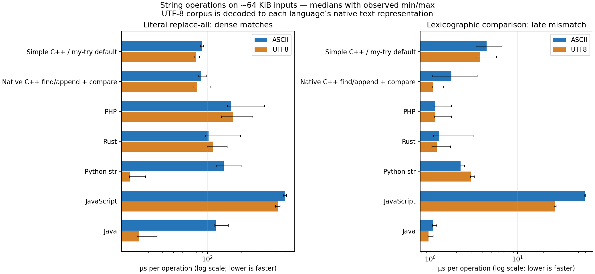

# Bulk byte comparison — 2026-10-21

Doc Status: supporting

The case-sensitive runtime helper now compares the common prefix with `std::memcmp`. This removes the scalar byte-at-a-time loop without changing the documented byte-ordering contract or UTF-8 defaults. Argument-copy optimization in my-try is documented in the separate
[safe snapshot-elision follow-up](../string_borrow_2026_10_21/README.md).

## Before and after

Median microseconds per operation on nominal 64 KiB inputs, fourteen batches across two process rounds in each dataset. The late-mismatch fixture adds one ASCII byte.

| Path | Input | Late mismatch before µs | After µs | Measured speedup |
| --- | --- | ---: | ---: | ---: |
| Direct runtime | ASCII | 20.849 | 1.078 | 19.34× |
| Direct runtime | UTF8 | 20.319 | 1.098 | 18.50× |
| Runtime + argument copies | ASCII | 20.992 | 3.399 | 6.18× |
| Runtime + argument copies | UTF8 | 19.948 | 3.433 | 5.81× |
| my-try default | ASCII | 25.815 | 4.438 | 5.82× |
| my-try default | UTF8 | 21.298 | 3.747 | 5.68× |
| my-try ordinary | ASCII | 45.969 | 3.132 | 14.68× |
| my-try ordinary | UTF8 | 41.617 | 3.130 | 13.30× |
| Native C++ | ASCII | 1.268 | 1.756 | 0.72× |
| Native C++ | UTF8 | 1.072 | 1.088 | 0.99× |

The runtime improvement appears with both ASCII and UTF-8 data because this operation compares bytes; it does not decode UTF-8. End-to-end my-try measurements still include string snapshots and generated-call overhead.

## Remaining argument-copy cost

| Path | ASCII early mismatch µs | UTF-8 early mismatch µs |
| --- | ---: | ---: |
| Direct runtime | 0.009 | 0.006 |
| Runtime + argument copies | 2.396 | 2.458 |
| my-try default | 2.331 | 2.386 |
| my-try ordinary | 2.306 | 2.451 |

The early-mismatch cases still show the cost of copying whole inputs before comparing a short prefix. The separate allocation probe retains zero allocations for direct comparison and two allocations for the snapshot control. This patch does not change call evaluation, ownership, or argument snapshots.

## Semantics and proof

The existing owner is [`ascii_compare_sensitive`](../../../../runtime/include/core/string_support.hpp). It compares the shared byte window using `memcmp`, then keeps the original length tie-break (`-1`, `0`, `1`). A zero-length guard avoids passing null data from empty views to `memcmp`. The [public contract](../../../../specs/builtins/string/substr_compare.md) requires a native compare-style result: ordering sign matters, not a portable mismatch magnitude. Embedded NULs, high bytes and malformed UTF-8 remain ordinary bytes. Offset/length normalization and ASCII case-insensitive comparison are unchanged.

The [native string tests](../../../../tests/runtime/native/test_php_string.cpp) passed with the new implementation, including all 65,536 single-byte pairs, empty views, prefix length ties, 32 alignment pairs, long equal buffers and mismatches around bulk block boundaries. Binary inputs exercise the three public arities, negative offsets/lengths and input immutability. Existing case-insensitive and normalization tests also pass.

Validation commands:

```bash
clang++ -std=c++23 -O2 -Iruntime/include tests/runtime/native/test_php_string.cpp runtime/include/core/runtime.cpp -o /tmp/scpp-string-compare-test
/tmp/scpp-string-compare-test
clang++ -std=c++23 -O1 -g -fsanitize=address,undefined -fno-omit-frame-pointer -Iruntime/include tests/runtime/native/test_php_string.cpp runtime/include/core/runtime.cpp -o /tmp/scpp-string-compare-sanitized
ASAN_OPTIONS=detect_leaks=0 /tmp/scpp-string-compare-sanitized
```

AddressSanitizer and UBSan passed. LeakSanitizer was disabled after reporting that it cannot operate under ptrace in this environment; no leak-check result is claimed. The compiler emitted the existing `hash_t` explicit-instantiation warning.

## Benchmark scope and reproducibility

The full [harness](../../benchmarks/string_defaults/README.md) was rerun: my-try default and ordinary lowering, direct runtime and snapshot controls, native C++, PHP, Rust, Python, JavaScript and Java, including representation/materialization variants. All 7,644 timed-batch checksums passed across 42 cases and 13 configurations. Corpus and all seven timed source hashes match the [baseline](../string_defaults_2026_10_21/README.md). Both new rounds used identical executable hashes.

The build uses revision `04a23a22fb5ea7dca06243db6651abc65f950ef1` plus the retained [runtime patch](runtime.patch). [Environment metadata](environment.json) records runtime source hashes, executable hashes and toolchain versions. Native benchmarks were rebuilt in a fresh directory with Clang 18 `-O3`; my-try used the production publisher/builder with no PCH or LTO. Processes ran sequentially on CPU 0 of the same Ryzen 5 PRO 4650G / WSL2 environment.

These are separate before/after runs, not interleaved paired trials. Background host activity and allocator/GC behavior can affect timings; unchanged native C++ and replacement controls also drift. Treat the large long-prefix improvement as evidence for removing the scalar loop, not every small timing difference as a code effect. Replacement code was unchanged.

- [Before/after comparison tables](before_after.md) and [all comparisons as CSV](before_after.csv).
- [All-language tables](tables.md), [summary and raw samples](summary.json), and [per-process medians](round_medians.json).
- [Validation counts](validation.json), [commands](commands.json), and `run_*.stdout` files (second round); `rounds/round1/` retains the first.


