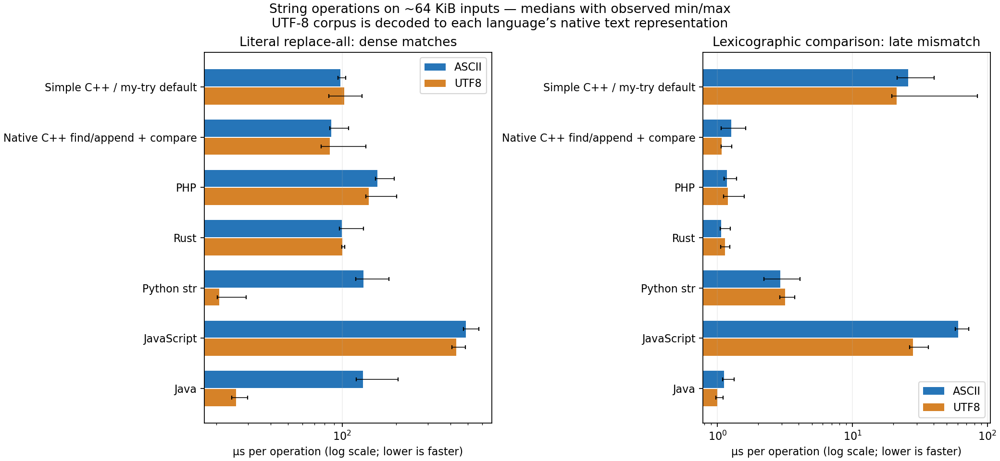

# String benchmark findings — 2026-10-21

Doc Status: supporting

This is the retained pre-fix baseline. See the [bulk-comparison follow-up](../string_bulk_compare_2026_10_21/README.md)
for the implemented runtime optimization and before/after measurements.

**The measured slow paths do not come from UTF-8 decoding.** They come from a
scalar byte-comparison loop, string argument snapshots, and workload-dependent
replacement/search/allocation behavior. This evidence does not justify changing
Unicode defaults.

The primary Simple C++ row runs strict PHS compiled through `compiler/my-try/`
with its default concrete lowering. The compiler was PHP-hosted; this measures
its generated native program, not compiler execution time. Before building,
`v0.2/develop` was fast-forwarded from `a0057fb1` to fetched
`04a23a22`. That remote update includes compiler/runtime fixes but does not change
the replacement/comparison helpers measured here. No performance fix or default
change was made as part of this benchmark.

## Primary measurements

Median microseconds per operation on approximately 64 KiB inputs; lower is faster.
Fourteen timed batches across two process runs. The full [tables](tables.md)
include 64-byte and 4-KiB inputs, no-match/growing replacements, all comparison
shapes and diagnostic configurations. [Raw samples](summary.json) retain min/max
and every batch result; [per-process medians](round_medians.json) expose drift.

| Implementation | Replace ASCII | Replace UTF-8 | Compare late ASCII | Compare late UTF-8 |
| --- | ---: | ---: | ---: | ---: |
| Simple C++ / my-try default | 97.96 | 102.78 | 25.82 | 21.30 |
| Native C++ | 87.08 | 85.51 | 1.27 | 1.07 |
| PHP | 157.04 | 140.40 | 1.18 | 1.19 |
| Rust | 99.53 | 100.33 | 1.07 | 1.13 |
| Python str | 131.47 | 20.69 | 2.91 | 3.16 |
| JavaScript | 487.10 | 429.54 | 60.45 | 28.06 |
| Java | 130.36 | 25.75 | 1.12 | 1.00 |

These are workload measurements, not language rankings. Python/JS use two
relational operators to produce a comparison sign. UTF-8 fixtures become native
Unicode strings in Python, JS and Java before timing. The two replacement needles
have the same byte length but different code-point counts. Library specializations,
native representation, match density and output size all affect the results.

## What accounts for the Simple C++ cost

### 1. Long-prefix comparison: the runtime loop is the main target

On the ASCII late-mismatch case:

| Path | Median µs/op |
| --- | ---: |
| Direct runtime `substr_compare` | 20.849 |
| Native C++ `std::string::compare` | 1.268 |
| Runtime plus explicit argument copies | 20.992 |
| Default my-try program | 25.815 |

The runtime is roughly **16× slower than native C++** here even before source
lowering. Equal-string comparison shows the same pattern: 17.114 µs versus
1.097 µs. The UTF-8 late-mismatch control is 20.319 µs versus 1.072 µs.

[`ascii_compare_sensitive`](../../../../runtime/include/core/string_support.hpp)
walks unsigned bytes one at a time. The native baseline reaches `memcmp` in its
compiled executable. Both implement exact byte ordering for these inputs; neither
needs Unicode decoding. The source inspection and isolated helper measurements
support optimizing the byte comparison algorithm as the first candidate.

This measures `substr_compare(s,t,0)`, not every language comparison operator or
the case-insensitive helper. A future implementation must preserve the public
contract and its offset/length behavior; these measurements alone are not an
approval to change it.

### 2. Early-exit comparison: copying arguments dominates

For 64 KiB ASCII strings differing at the first character:

| Path | Median µs/op |
| --- | ---: |
| Direct runtime comparison | about 0.005 |
| Runtime plus explicit argument copies | 2.298 |
| Default my-try program | 2.321 |
| Ordinary my-try lowering | 2.198 |

Generated calls copy both complete string arguments before entering the comparison.
The explicit-copy control closely reproduces the emitted-program cost. Its
allocation probe records two allocations requesting 131,074 bytes for this case,
while the direct helper allocates nothing.

This changes practical early-exit cost from inspecting a prefix to copying the
whole inputs first. Evidence is retained in the generated
[concrete unit](generated_evidence/concrete_unit.cpp.txt),
[ordinary unit](generated_evidence/ordinary_unit.cpp.txt), and
[concrete string copy/provider bridges](generated_evidence/concrete_string_copy.txt).

Snapshot removal is not automatically safe: argument evaluation order and mutation
semantics still have to hold. Any follow-up should establish when borrowing is
provably safe within the call/lowering owner, rather than deleting copies globally.

### 3. Concrete lowering adds visible cost to short operations

The 64-byte length-and-accumulate control takes approximately 49 ns/iteration under
default concrete lowering, 15 ns with ordinary lowering, and 15 ns with the explicit
C++ snapshot control. Direct runtime length is about 1–2 ns with the harness barrier.

Concrete emission uses out-of-line primitive operations and provider bridges;
ordinary emission exposes more operations to the optimizer. This is a useful
follow-up area for short operations, but not proof that concrete lowering is
uniformly slower: its long comparisons were faster than ordinary emission in this
build. The control includes the string snapshot and arithmetic loop; it is not a
measurement of an isolated bridge call and is not subtracted from other timings.

### 4. Replacement is workload-dependent, not uniformly slow

On dense ASCII replacement, default my-try is 97.961 µs, direct runtime 88.014 µs,
and the matching native find/append algorithm 87.084 µs. PHP is 157.037 µs in this
corpus. On an absent needle, default my-try is 3.527 µs versus PHP's 17.033 µs.
These cases do not show a blanket replacement performance deficit.

Growing output is different: PHP/Rust are faster than our current algorithm in the
pooled measurements. The allocation control shows why growth deserves investigation:

| 64 KiB ASCII replacement | Current runtime allocations | Initially reserve subject size |
| --- | ---: | ---: |
| Dense shrinking output | 12 | 1 |
| Growing output | 14 | 3 |

Fewer allocations do not guarantee a proportional speedup. Dense ASCII native
replacement changes only from 87.084 to 82.080 µs with reserve. ASCII growing output
does not improve in the pooled medians (290.357 versus 295.102 µs); UTF-8 growing
output improves from 279.005 to 95.951 µs. Output lengths and capacity-growth steps
differ between those fixtures. Initial reservation is a useful experiment, not a
universal fix established by these data.

Growing replacements are especially variable: default my-try UTF-8 process medians
were approximately **623 µs and 238 µs**. Do not treat the pooled 315 µs as a precise,
stable latency prediction. Allocation strategy, process state and host scheduling
need controlled follow-up before assigning small percentage differences to a cause.
The allocation probe measures requested allocation sizes, not memcpy traffic or
peak memory. [Allocation results](alloc_runtime.csv),
[snapshot control](alloc_runtime_snapshot.csv), [reserve control](alloc_cpp_reserved.csv).

## What this says about UTF-8 defaults

The measured replacement and comparison implementations operate on native bytes.
There is no UTF-8 decode/count/index conversion in these hot paths. Long-prefix
comparison is slow on both ASCII and UTF-8, and the argument-copy penalty appears
on both as well.

The Unicode-language rows do not isolate an encoding tax: Python and Java can
process a one-code-point needle differently from a two-code-point needle, and JS
may retain deferred string representations until a later consumer. The separate
Python-bytes and JS-output-materialization rows make these distinctions visible.
No result here measures code-point slicing, grapheme iteration, Unicode case folding,
normalization or collation.

The evidence supports fixing exact byte operations and measuring safe call-boundary
improvements before revisiting default string semantics.

## Reproducibility, validation and limits

The [harness and methodology](../../benchmarks/string_defaults/README.md) describe
the APIs, corpus generator, timing boundaries, JIT barriers, allocation probe and
reproduction commands. There are 42 cases × 13 configurations × 2 process rounds
× 7 batches = **7,644 recorded timed batches**. All per-case expected outputs and
all batch checksums pass. Seven timed-source hashes were checked against the
recorded environment. No runtime implementation was modified.

Environment: AMD Ryzen 5 PRO 4650G, Linux under WSL2; sequential processes pinned
to CPU 0. Clang 18.1.3 with `-O3`, PHP 8.5.7 with extensions/JIT disabled for its
timed target, Rust 1.75.0 with `-O`, Python 3.12.3, Node 22.23.1 and OpenJDK
21.0.12.1. These are the measured versions, not a claim about the newest releases.
Direct C++ uses C++20; the my-try native builder uses C++23. No LTO or PCH was used.
[Full versions, source/executable hashes](environment.json), [commands](commands.json),
[CSV summary](summary.csv), [exact corpus dimensions](cases.json).

The initial JS run was rejected because invariant comparisons were hoisted out of
the loop; reported JS samples use an explicit V8 optimization barrier. Initial Java
samples with inadequate warmup were replaced with longer warmup and `-Xbatch`.
Neither rejected set is included in the tables. Remaining variation is visible in
the ranges and per-process medians. These are local warm microbenchmarks, not an
end-to-end production workload or a statistically controlled hardware laboratory.

Corpus setup exposed an unrelated concrete `explode` return-transport failure;
the harness instead loads individual fixtures outside timing. The concrete Ninja
builder is unsupported, so both programs use the production native-cache builder.
These setup limitations are documented in the harness; neither was patched.
